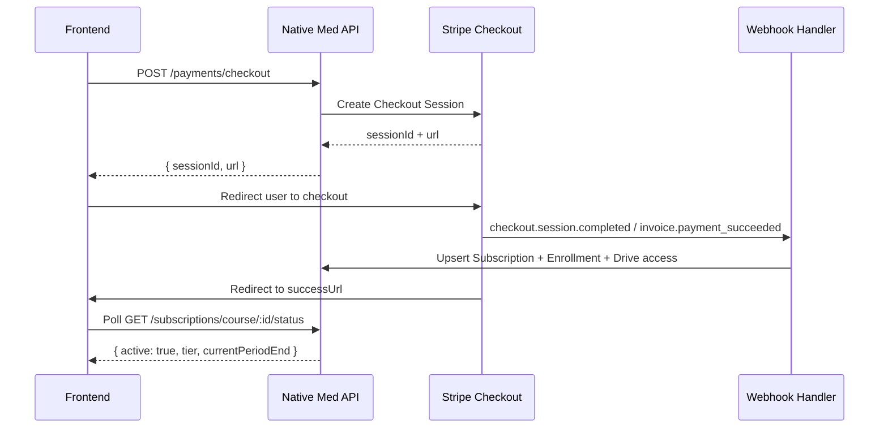

# Frontend Integration Guide — Courses, Subscriptions & Stripe

This document describes the backend changes the frontend needs to implement: course creation with Google Drive links and pricing, the new subscription model, and Stripe checkout/billing integration.

**Base URL:** `{API_URL}/api/v1`  
**Auth:** Bearer token in `Authorization: Bearer <accessToken>` header (except public routes).

All successful responses follow:

```json
{
  "success": true,
  "message": "Human-readable message",
  "data": { /* payload */ }
}
```

Errors:

```json
{
  "success": false,
  "message": "Error message",
  "errors": { /* optional validation details */ }
}
```

---

## Table of contents

1. [Summary of backend changes](#1-summary-of-backend-changes)
2. [Data model overview](#2-data-model-overview)
3. [Admin — course creation & editing](#3-admin--course-creation--editing)
4. [Public course display & pricing](#4-public-course-display--pricing)
5. [Subscription plans](#5-subscription-plans)
6. [Stripe integration](#6-stripe-integration)
7. [Access control — what to show users](#7-access-control--what-to-show-users)
8. [Endpoint reference](#8-endpoint-reference)
9. [Recommended UI flows](#9-recommended-ui-flows)
10. [TypeScript types (frontend)](#10-typescript-types-frontend)
11. [Testing checklist](#11-testing-checklist)

---

## 1. Summary of backend changes

| Area | What changed |
|------|--------------|
| **Course creation** | Admins must provide **two Google Drive folder links** (`lecturesDriveFolderId`, `mockSessionsDriveFolderId`) and **per-tier pricing** — both `mocksessions_only` and `mocksession_and_lectures` must each have at least one of monthly/quarterly set (`pricing` object). |
| **Course responses** | Public course objects now include a `pricing` object keyed by access tier (GBP). Drive folder IDs are **never** returned on public endpoints, but **are** included on admin GET/create/update responses so edit forms can pre-fill them. |
| **Subscriptions** | New subscription system with two product types: **Case Bank** and **Course**. Course subscriptions have two **access tiers**. |
| **Payments** | Stripe Checkout (hosted) for all purchases. Backend creates checkout sessions; webhooks activate subscriptions and enrollments. |
| **Enrollments** | Course access is granted via subscription → enrollment → Google Drive permissions. Use enrollment/subscription status endpoints to gate UI. |
| **Billing** | Users can open Stripe Billing Portal to manage/cancel subscriptions. |

---

## 2. Data model overview

### Course

```ts
interface TierPricing {
  monthly?: number;   // GBP, e.g. 49.99
  quarterly?: number; // GBP, e.g. 129.99
}

interface CoursePricing {
  mocksessions_only: TierPricing;
  mocksession_and_lectures: TierPricing;
}

interface Course {
  _id: string;
  title: string;
  description: string;
  pricing: CoursePricing;
  thumbnailUrl?: string;
  isPublished: boolean;
  createdBy?: string;         // admin detail only
  createdAt: string;
  updatedAt: string;
}
```

> **Note:** `lecturesDriveFolderId` and `mockSessionsDriveFolderId` are accepted on **create/update** and are returned on **admin** responses (`GET /courses/admin/all`, `GET /courses/admin/:id`, `POST /courses`, `PATCH /courses/:id`) so the edit form can pre-fill them. They are still **stripped from public responses** (`GET /courses`, `GET /courses/:id`) — never expose them to non-admin clients.

### Subscription types

| `type` | Description |
|--------|-------------|
| `case_bank` | Monthly access to all mock clinical cases |
| `course` | Recurring access to a specific course (monthly or quarterly) |

### Course access tiers (course subscriptions only)

| `tier` | Google Drive access |
|--------|---------------------|
| `mocksessions_only` | Mock sessions folder only |
| `mocksession_and_lectures` | Mock sessions folder **and** lectures folder |

Tier controls *what* the user gets (Drive folders) and *how much they pay* — each tier has its own monthly/quarterly price on `course.pricing`. Interval controls *how often* they are billed. Both tiers give access to the course PDF regardless of which one is purchased.

### Billing intervals

| `interval` | Meaning |
|------------|---------|
| `monthly` | Billed every month |
| `quarterly` | Billed every 3 months |

Case Bank is **monthly only**.

### Subscription status

| `status` | Frontend behaviour |
|----------|-------------------|
| `active` | Full access |
| `past_due` | Still has access (payment retry in progress) — show warning banner |
| `cancelled` | No access (or access until period end if `cancelAtPeriodEnd`) |
| `expired` | No access |

---

## 3. Admin — course creation & editing

### Create course

**`POST /api/v1/courses`** · Admin auth required

#### Request body

```json
{
  "title": "Onah Chinedum",
  "description": "Course materials including lectures and mock sessions on Google Drive.",
  "pricing": {
    "mocksessions_only": { "monthly": 29.99, "quarterly": 79.99 },
    "mocksession_and_lectures": { "monthly": 49.99, "quarterly": 129.99 }
  },
  "lecturesDriveFolderId": "https://drive.google.com/drive/folders/10aYg5EFRmbyrhJpGbPcUhny9ST9kAL-T",
  "mockSessionsDriveFolderId": "https://drive.google.com/drive/folders/10aYg5EFRmbyrhJpGbPcUhny9ST9kAL-T",
  "isPublished": false
}
```

#### Field rules

| Field | Required | Notes |
|-------|----------|-------|
| `title` | Yes | Min 3 characters |
| `description` | Yes | Min 10 characters |
| `pricing.mocksessions_only` | Yes | Must have at least one of `monthly`/`quarterly`, Number ≥ 0, GBP |
| `pricing.mocksession_and_lectures` | Yes | Must have at least one of `monthly`/`quarterly`, Number ≥ 0, GBP |
| `lecturesDriveFolderId` | Yes on create | Full Google Drive folder URL **or** raw folder ID |
| `mockSessionsDriveFolderId` | Yes on create | Full Google Drive folder URL **or** raw folder ID |
| `isPublished` | No | Defaults to `false` |

#### Accepted Drive link formats

The backend extracts the folder ID from any of:

- Raw ID: `10aYg5EFRmbyrhJpGbPcUhny9ST9kAL-T`
- Folder URL: `https://drive.google.com/drive/folders/<ID>`
- File URL: `https://drive.google.com/file/d/<ID>/view`
- Open URL: `https://drive.google.com/open?id=<ID>`

Invalid links return `400` with message `"Invalid Google Drive folder link or ID"`.

#### Admin form UI recommendations

1. **Title** and **description** — text inputs
2. **Pricing section** (per tier — repeat for both tiers)
   - "Mock Sessions + Lectures": monthly £ / quarterly £ — at least one required
   - "Mock Sessions Only": monthly £ / quarterly £ — at least one required
3. **Google Drive links section**
   - Lectures folder link — URL input with helper text: *"Share this folder with the Native Med service account (Editor role)"*
   - Mock sessions folder link — URL input (same helper)
4. **Publish toggle** — optional on create; or use separate publish endpoint after thumbnail upload

#### Response (`201`)

Returns the created course **without** drive folder IDs:

Admin-only response — includes the Drive folder IDs (see `AdminCourse` in [§10](#10-typescript-types-frontend)):

```json
{
  "success": true,
  "message": "Course created",
  "data": {
    "_id": "6789abc...",
    "title": "Onah Chinedum",
    "description": "...",
    "pricing": {
      "mocksessions_only": { "monthly": 29.99, "quarterly": 79.99 },
      "mocksession_and_lectures": { "monthly": 49.99, "quarterly": 129.99 }
    },
    "lecturesDriveFolderId": "10aYg5EFRmbyrhJpGbPcUhny9ST9kAL-T",
    "mockSessionsDriveFolderId": "10aYg5EFRmbyrhJpGbPcUhny9ST9kAL-T",
    "isPublished": false,
    "createdAt": "2026-08-07T...",
    "updatedAt": "2026-08-07T..."
  }
}
```

### Update course

**`PATCH /api/v1/courses/:id`** · Admin auth required

All fields optional. Same validation as create when prices or drive links are sent.

```json
{
  "pricing": {
    "mocksession_and_lectures": { "monthly": 59.99 }
  },
  "lecturesDriveFolderId": "https://drive.google.com/drive/folders/NEW_ID"
}
```

Pricing updates merge per tier/interval against the existing values — the example above only changes `mocksession_and_lectures.monthly` and leaves `mocksession_and_lectures.quarterly` and the whole `mocksessions_only` tier untouched. After the merge, both tiers must still have at least one of `monthly`/`quarterly` set.

### Other admin course endpoints (unchanged pattern)

| Method | Path | Purpose |
|--------|------|---------|
| `GET` | `/courses/admin/all?page=1&limit=20&search=` | Paginated admin list |
| `GET` | `/courses/admin/:id` | Admin detail (includes unpublished) |
| `PATCH` | `/courses/:id/thumbnail` | Multipart `thumbnail` file field |
| `PATCH` | `/courses/:id/publish` | Toggle `isPublished` |
| `DELETE` | `/courses/:id` | Delete course — cascades: unenrolls every enrolled user (Drive access revoked) and cancels their Stripe subscriptions for this course |

---

## 4. Public course display & pricing

### List published courses

**`GET /api/v1/courses`** · Public

Returns array of courses with pricing fields for display on catalog/pricing cards.

### Course detail

**`GET /api/v1/courses/:id`** · Public (published only)

Use `course.pricing[tier]` to render purchase options once the user has picked a tier:

```tsx
// Example pricing display logic
function CoursePricing({ course, tier }: { course: Course; tier: CourseAccessTier }) {
  const price = course.pricing[tier];
  return (
    <div>
      {price.monthly != null && (
        <button onClick={() => checkout(tier, 'monthly')}>
          £{price.monthly.toFixed(2)} / month
        </button>
      )}
      {price.quarterly != null && (
        <button onClick={() => checkout(tier, 'quarterly')}>
          £{price.quarterly.toFixed(2)} / quarter
        </button>
      )}
    </div>
  );
}
```

If only one interval is set for a tier, hide the other billing option for that tier. Checkout will return `400` if the user picks a tier/interval combination the course does not support.

---

## 5. Subscription plans

### Fetch available plans

**`GET /api/v1/subscriptions/plans`** · Public  
**`GET /api/v1/payments/plans`** · Public (same data)

Both endpoints return identical plan definitions.

#### Example response

```json
{
  "success": true,
  "message": "Plans fetched",
  "data": [
    {
      "type": "case_bank",
      "name": "Case Bank Access",
      "description": "Unlimited access to all mock clinical cases for one month.",
      "prices": [
        {
          "amount": 2499,
          "currency": "gbp",
          "interval": "monthly",
          "stripePriceId": "price_xxx",
          "label": "£24.99 / month"
        }
      ]
    },
    {
      "type": "course",
      "tier": "mocksessions_only",
      "name": "Course — Mock Sessions Only",
      "description": "Access to mock session materials on Google Drive. Price is set per course.",
      "prices": []
    },
    {
      "type": "course",
      "tier": "mocksession_and_lectures",
      "name": "Course — Mock Sessions + Lectures",
      "description": "Access to mock sessions and lecture materials on Google Drive. Price is set per course.",
      "prices": []
    }
  ]
}
```

### Important pricing rules

| Product | Where price comes from |
|---------|------------------------|
| **Case Bank** | Fixed in backend (`£24.99/month`). `prices[0].stripePriceId` is used server-side. |
| **Course** | **Per-course, per-tier** `course.pricing[tier].monthly` / `.quarterly`. Plan `prices` arrays are empty — use the course object for display amounts, keyed by the tier the user selects. |

### Course checkout tier selection UI

Before checkout, the user must pick:

1. **Access tier** — `mocksessions_only` or `mocksession_and_lectures` (each priced independently — show both prices so the user can compare)
2. **Billing interval** — `monthly` or `quarterly` (only if that price exists on the course **for the selected tier**)

Suggested copy (matches backend labels):

| Tier value | Display label |
|------------|---------------|
| `mocksessions_only` | Mock Sessions Only |
| `mocksession_and_lectures` | Mock Sessions + Lectures |

---

## 6. Stripe integration

The backend uses **Stripe Checkout** (hosted payment page). The frontend never handles card data directly.

### Environment variable (frontend)

Add the publishable key you were given:

```env
# .env.local (Next.js) or equivalent
NEXT_PUBLIC_STRIPE_PUBLISHABLE_KEY=pk_test_...   # or pk_live_... in production
```

> Use the **test** publishable key with test API/backend during development.

### Checkout flow (recommended)

There are two equivalent ways to send the user to Stripe Checkout:

#### Option A — Direct redirect (simplest, no Stripe.js)

```ts
async function startCheckout(body: CheckoutRequest) {
  const res = await fetch(`${API_URL}/api/v1/payments/checkout`, {
    method: 'POST',
    headers: {
      'Content-Type': 'application/json',
      Authorization: `Bearer ${accessToken}`,
    },
    body: JSON.stringify(body),
  });

  const json = await res.json();
  if (!json.success) throw new Error(json.message);

  // Redirect to Stripe-hosted checkout page
  window.location.href = json.data.url;
}
```

#### Option B — Stripe.js redirect (uses publishable key)

```bash
npm install @stripe/stripe-js
```

```ts
import { loadStripe } from '@stripe/stripe-js';

const stripePromise = loadStripe(process.env.NEXT_PUBLIC_STRIPE_PUBLISHABLE_KEY!);

async function startCheckout(body: CheckoutRequest) {
  const res = await fetch(`${API_URL}/api/v1/payments/checkout`, {
    method: 'POST',
    headers: {
      'Content-Type': 'application/json',
      Authorization: `Bearer ${accessToken}`,
    },
    body: JSON.stringify(body),
  });

  const json = await res.json();
  if (!json.success) throw new Error(json.message);

  const stripe = await stripePromise;
  if (!stripe) throw new Error('Stripe failed to load');

  const { error } = await stripe.redirectToCheckout({
    sessionId: json.data.sessionId,
  });

  if (error) console.error(error.message);
}
```

Both options call the same backend endpoint. Option A is sufficient; Option B is useful if you already load Stripe.js for other features.

### Create checkout session

**`POST /api/v1/payments/checkout`** · Auth required

#### Case Bank checkout

```json
{
  "type": "case_bank",
  "interval": "monthly",
  "successUrl": "https://yourapp.com/payment/success?session_id={CHECKOUT_SESSION_ID}",
  "cancelUrl": "https://yourapp.com/payment/cancelled"
}
```

- `interval` must be `"monthly"` for Case Bank
- `courseId` and `tier` are not required

#### Course checkout

```json
{
  "type": "course",
  "tier": "mocksession_and_lectures",
  "interval": "monthly",
  "courseId": "6789abc123def45678901234",
  "successUrl": "https://yourapp.com/payment/success?session_id={CHECKOUT_SESSION_ID}",
  "cancelUrl": "https://yourapp.com/payment/cancelled"
}
```

| Field | Required | Values |
|-------|----------|--------|
| `type` | Yes | `"case_bank"` \| `"course"` |
| `tier` | Yes for `course` | `"mocksessions_only"` \| `"mocksession_and_lectures"` |
| `interval` | Yes | `"monthly"` \| `"quarterly"` |
| `courseId` | Yes for `course` | 24-char MongoDB ObjectId |
| `successUrl` | No | Defaults to `{CLIENT_URL}/payment/success?session_id={CHECKOUT_SESSION_ID}` |
| `cancelUrl` | No | Defaults to `{CLIENT_URL}/payment/cancelled` |

#### Success response

```json
{
  "success": true,
  "message": "Checkout session created",
  "data": {
    "sessionId": "cs_test_...",
    "url": "https://checkout.stripe.com/c/pay/cs_test_..."
  }
}
```

#### Error cases to handle

| Status | Message | UI action |
|--------|---------|-----------|
| `409` | Already have an active Case Bank subscription | Link to account / billing portal |
| `409` | Already have an active subscription for this course | Show "Manage subscription" |
| `400` | Course not available for `{interval}` billing | Hide that interval in UI |
| `400` | Course is not available for purchase | Course unpublished — hide buy button |
| `404` | Course not found | Show 404 |

### Success & cancel pages

Create two routes (or reuse defaults the backend expects):

| Route | Purpose |
|-------|---------|
| `/payment/success` | Shown after Stripe redirects back. Query param `session_id` is available but **access is granted via webhook** — poll subscription status rather than assuming immediate access. |
| `/payment/cancelled` | User closed checkout without paying |

#### Post-checkout polling pattern

Webhooks may take 1–3 seconds. After redirect to success page:

```ts
async function waitForAccess(courseId: string, maxAttempts = 10) {
  for (let i = 0; i < maxAttempts; i++) {
    const res = await fetch(`${API_URL}/api/v1/subscriptions/course/${courseId}/status`, {
      headers: { Authorization: `Bearer ${accessToken}` },
    });
    const json = await res.json();
    if (json.data?.active) return json.data;

    await new Promise((r) => setTimeout(r, 1500));
  }
  throw new Error('Subscription not active yet — please refresh or contact support');
}
```

For Case Bank, poll `GET /api/v1/subscriptions/case-bank/status` instead.

### Billing portal (manage / cancel subscription)

**`POST /api/v1/payments/billing-portal`** · Auth required

```json
{
  "returnUrl": "https://yourapp.com/account/billing"
}
```

Response:

```json
{
  "success": true,
  "message": "Billing portal session created",
  "data": {
    "url": "https://billing.stripe.com/session/..."
  }
}
```

Redirect the user to `data.url`. They can update payment method, view invoices, and cancel.

Returns `404` if the user has no active subscription.

### Payment history

**`GET /api/v1/payments/me?page=1&limit=20`** · Auth required

```json
{
  "success": true,
  "message": "Payments fetched",
  "data": {
    "items": [
      {
        "_id": "...",
        "amount": 4999,
        "currency": "gbp",
        "status": "succeeded",
        "itemType": "course",
        "tier": "mocksession_and_lectures",
        "billingInterval": "monthly",
        "courseId": { "_id": "...", "title": "Onah Chinedum" },
        "paidAt": "2026-08-07T12:00:00.000Z"
      }
    ],
    "total": 1,
    "page": 1,
    "limit": 20,
    "totalPages": 1
  }
}
```

> **Amounts are in pence** (e.g. `4999` = £49.99). Course list prices from the course API are in **GBP pounds**.

---

## 7. Access control — what to show users

Use these endpoints to gate content. Do **not** rely on client-side price/session state alone.

### Course access

| Check | Endpoint | Use when |
|-------|----------|----------|
| Enrolled? | `GET /enrollments/check/:courseId` | Show course content vs paywall |
| Subscription detail | `GET /subscriptions/course/:courseId/status` | Show tier, renewal date, cancel-at-period-end banner |
| My enrollments | `GET /enrollments/me` | "My courses" dashboard |

#### Enrollment check response

```json
// Not enrolled
{ "success": true, "data": { "enrolled": false } }

// Enrolled
{
  "success": true,
  "data": {
    "enrolled": true,
    "accessTier": "mocksession_and_lectures",
    "accessGrantedAt": "2026-08-07T12:00:00.000Z"
  }
}
```

#### Course subscription status

```json
// No active subscription
{ "success": true, "data": { "active": false } }

// Active
{
  "success": true,
  "data": {
    "active": true,
    "tier": "mocksession_and_lectures",
    "currentPeriodEnd": "2026-09-07T12:00:00.000Z",
    "cancelAtPeriodEnd": false,
    "billingInterval": "monthly"
  }
}
```

#### Course content (PDFs, etc.)

**`GET /api/v1/courses/:courseId/content`** · Auth + enrollment required

Returns `403` if not enrolled. Gate the content tab behind enrollment check.

> Google Drive folders are shared directly to the user's email by the backend — there is no Drive link in the API. In-app copy: *"Check your email for Google Drive access"* or link to Google Drive home.

### Case Bank access

| Check | Endpoint |
|-------|----------|
| Has access? | `GET /subscriptions/case-bank/status` |
| Use cases API | Case endpoints return `403` if no active Case Bank subscription |

```json
// Active
{
  "success": true,
  "data": {
    "active": true,
    "currentPeriodEnd": "2026-09-07T12:00:00.000Z",
    "cancelAtPeriodEnd": false,
    "billingInterval": "monthly"
  }
}
```

### My subscriptions (account page)

**`GET /api/v1/subscriptions/me`** · Auth required

Returns all subscriptions (active and historical) with populated course info:

```json
{
  "success": true,
  "data": [
    {
      "_id": "...",
      "type": "course",
      "courseId": { "_id": "...", "title": "Onah Chinedum", "thumbnailUrl": "..." },
      "tier": "mocksession_and_lectures",
      "billingInterval": "monthly",
      "status": "active",
      "currentPeriodEnd": "2026-09-07T12:00:00.000Z",
      "cancelAtPeriodEnd": false
    }
  ]
}
```

---

## 8. Endpoint reference

### Courses

| Method | Path | Auth | Description |
|--------|------|------|-------------|
| `GET` | `/courses` | — | List published courses (includes prices) |
| `GET` | `/courses/:id` | — | Published course detail |
| `GET` | `/courses/admin/all` | Admin | All courses (paginated) |
| `GET` | `/courses/admin/:id` | Admin | Course detail (incl. unpublished) |
| `POST` | `/courses` | Admin | **Create** — prices + 2 Drive links |
| `PATCH` | `/courses/:id` | Admin | Update course |
| `PATCH` | `/courses/:id/thumbnail` | Admin | Upload thumbnail (multipart) |
| `PATCH` | `/courses/:id/publish` | Admin | Toggle publish |
| `DELETE` | `/courses/:id` | Admin | Delete course — unenrolls all users and cancels their subscriptions for it |

### Subscriptions

| Method | Path | Auth | Description |
|--------|------|------|-------------|
| `GET` | `/subscriptions/plans` | — | All plan definitions |
| `GET` | `/subscriptions/me` | User | User's subscriptions |
| `GET` | `/subscriptions/case-bank/status` | User | Case Bank access check |
| `GET` | `/subscriptions/course/:courseId/status` | User | Course subscription check |
| `GET` | `/subscriptions/subscribers` | Admin | All subscribers list |

### Payments

| Method | Path | Auth | Description |
|--------|------|------|-------------|
| `GET` | `/payments/plans` | — | Same as `/subscriptions/plans` |
| `POST` | `/payments/checkout` | User | Create Stripe Checkout session |
| `POST` | `/payments/billing-portal` | User | Open Stripe billing portal |
| `GET` | `/payments/me` | User | Payment history (paginated) |
| `POST` | `/payments/webhook` | Stripe | **Backend only** — do not call from frontend |

### Enrollments

| Method | Path | Auth | Description |
|--------|------|------|-------------|
| `GET` | `/enrollments/me` | User | Active enrollments |
| `GET` | `/enrollments/check/:courseId` | User | Enrollment status for a course |
| `POST` | `/enrollments/manual` | Admin | Comp/gift access |
| `POST` | `/enrollments/revoke` | Admin | Revoke access |

---

## 9. Recommended UI flows

### Admin — create course wizard

```
Step 1: Basic info (title, description)
Step 2: Pricing — per tier (mocksessions_only, mocksession_and_lectures), monthly £ / quarterly £ each — at least one per tier required
Step 3: Google Drive links (lectures + mock sessions folders)
Step 4: Thumbnail upload (PATCH /courses/:id/thumbnail)
Step 5: Publish (PATCH /courses/:id/publish)
```

### Student — purchase course

```
Course detail page
  → Show prices from course.pricing[tier] for both tiers
  → User selects tier (Mock Sessions Only vs Mock Sessions + Lectures)
  → User selects interval (monthly / quarterly — only show available)
  → POST /payments/checkout
  → Redirect to Stripe
  → Return to /payment/success
  → Poll GET /subscriptions/course/:courseId/status
  → Redirect to course content / show Drive access message
```

### Student — Case Bank

```
Pricing page — show £24.99/month from plans endpoint
  → POST /payments/checkout { type: "case_bank", interval: "monthly" }
  → Redirect to Stripe
  → Poll GET /subscriptions/case-bank/status
  → Unlock cases UI
```

### Account / billing page

```
GET /subscriptions/me          — list all subscriptions
GET /payments/me               — payment history
POST /payments/billing-portal  — "Manage billing" button → Stripe portal
```

---

## 10. TypeScript types (frontend)

Copy into your frontend codebase:

```ts
export type SubscriptionType = 'case_bank' | 'course';
export type CourseAccessTier = 'mocksessions_only' | 'mocksession_and_lectures';
export type BillingInterval = 'monthly' | 'quarterly';
export type SubscriptionStatus = 'active' | 'expired' | 'cancelled' | 'past_due';

export interface TierPricing {
  monthly?: number;
  quarterly?: number;
}

export interface CoursePricing {
  mocksessions_only: TierPricing;
  mocksession_and_lectures: TierPricing;
}

export interface Course {
  _id: string;
  title: string;
  description: string;
  pricing: CoursePricing;
  thumbnailUrl?: string;
  isPublished: boolean;
  createdAt: string;
  updatedAt: string;
}

/** Admin-only response shape — GET/create/update on /courses/admin/* and /courses. */
export interface AdminCourse extends Course {
  lecturesDriveFolderId: string;
  mockSessionsDriveFolderId: string;
  createdBy?: { _id: string; fullName: string; email: string } | string;
}

export interface CreateCoursePayload {
  title: string;
  description: string;
  pricing: CoursePricing;
  lecturesDriveFolderId: string;
  mockSessionsDriveFolderId: string;
  isPublished?: boolean;
}

export interface PlanPrice {
  amount: number;       // pence
  currency: 'gbp';
  interval: BillingInterval;
  stripePriceId: string;
  label: string;
}

export interface PlanDefinition {
  type: SubscriptionType;
  tier?: CourseAccessTier;
  name: string;
  description: string;
  prices: PlanPrice[];
}

export interface CheckoutRequest {
  type: SubscriptionType;
  tier?: CourseAccessTier;
  interval: BillingInterval;
  courseId?: string;
  successUrl?: string;
  cancelUrl?: string;
}

export interface CheckoutResponse {
  sessionId: string;
  url: string;
}

export interface CourseSubscriptionStatus {
  active: false;
} | {
  active: true;
  tier: CourseAccessTier;
  currentPeriodEnd: string;
  cancelAtPeriodEnd: boolean;
  billingInterval: BillingInterval;
}

export interface CaseBankStatus {
  active: false;
} | {
  active: true;
  currentPeriodEnd: string;
  cancelAtPeriodEnd: boolean;
  billingInterval: BillingInterval;
}

export interface EnrollmentCheck {
  enrolled: false;
} | {
  enrolled: true;
  accessTier: CourseAccessTier;
  accessGrantedAt: string;
}
```

---

## 11. Testing checklist

### Admin course creation
- [ ] Create course with both tiers fully priced (monthly + quarterly) and both Drive links
- [ ] Create course with only `monthly` set on each tier (no quarterly)
- [ ] Validation error when a tier is missing entirely
- [ ] Validation error when a tier has neither `monthly` nor `quarterly`
- [ ] Validation error on invalid Drive URL
- [ ] Update a course to change only one tier's pricing — confirm the other tier is untouched
- [ ] Publish course and confirm it appears in `GET /courses`

### Course purchase (Stripe test mode)
- [ ] Use test card `4242 4242 4242 4242`, any future expiry, any CVC
- [ ] Monthly + `mocksessions_only` checkout
- [ ] Quarterly + `mocksession_and_lectures` checkout
- [ ] Success page polls until `subscriptions/course/:id/status` returns `active: true`
- [ ] `GET /enrollments/check/:courseId` returns `enrolled: true`
- [ ] Duplicate checkout returns `409`

### Case Bank
- [ ] Checkout with `type: "case_bank"`, `interval: "monthly"`
- [ ] Cases UI unlocks after `case-bank/status` is active

### Billing portal
- [ ] "Manage billing" opens Stripe portal for subscribed user
- [ ] Returns `404` for user with no subscription

### Edge cases
- [ ] Unpublished course — checkout returns `400`
- [ ] Cancel checkout — user lands on cancel URL, no subscription created
- [ ] Payment amounts in history displayed as `amount / 100` GBP

---

## Architecture diagram



---

## Questions / backend follow-ups

If the frontend team needs any of the following, coordinate with backend:

1. **Public config endpoint** exposing `STRIPE_PUBLISHABLE_KEY` — currently shared out-of-band
2. **Upgrade tier flow** — changing from `mocksessions_only` to `mocksession_and_lectures` mid-subscription may require a new checkout session (not yet a dedicated endpoint)

For Postman examples of every request, see `postman/NativeMed.postman_collection.json` in the repo.
